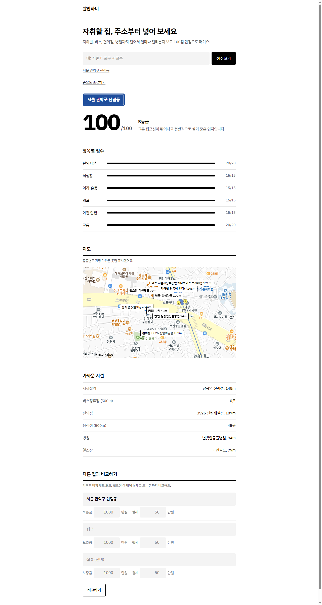

# 살만하니

자취할 집 주소를 넣으면 주변 생활 인프라(지하철·버스·편의점·병원 등)까지의 거리를 따져 **100점 만점 입지 점수**를 매겨 주는 웹앱입니다.



## 주요 기능

- **입지 점수와 등급**: 6개 항목 점수를 합산해 S~F 등급으로 표시
- **중요도 조절**: 슬라이더로 항목별 가중치를 바꿔 내 생활 패턴에 맞게 재계산
- **지도**: 카카오맵에 위치와 종류별 가장 가까운 시설 표시
- **가까운 시설 요약**: 지하철역, 버스정류장 수, 편의점, 음식점 수, 병원, 헬스장
- **집 비교**: 최대 3곳의 점수와 보증금·월세를 나란히 비교
- **AI 한줄평**: OpenAI 키가 있으면 GPT 코멘트, 없으면 규칙 기반 코멘트
- **최근 검색**: 브라우저(localStorage)에 저장

## 기술 스택

| 구분 | 사용 |
|------|------|
| 백엔드 | Python, Flask |
| 프론트엔드 | HTML, CSS, Vanilla JS |
| 외부 API | 카카오 로컬(주소→좌표, 장소 검색), 카카오맵 JS SDK, 공공데이터포털 TAGO 버스정류소, OpenAI |

## 점수 계산 방식

`scoring.py`에서 항목별로 0~1점을 낸 뒤 가중치를 곱해 합산합니다.

| 항목 | 기본 가중치 | 기준 |
|------|------|------|
| 교통 | 20 | 가장 가까운 지하철역 거리 + 버스정류장 수 |
| 편의시설 | 20 | 편의점·마트 |
| 식생활 | 15 | 음식점·카페 |
| 의료 | 15 | 병원·약국 |
| 여가·운동 | 15 | 헬스장 |
| 야간 안전 | 15 | 반경 500m 편의점 밀도 (24시간 조명이 있는 가게를 대리 지표로 사용) |

등급: S(90+), A(80+), B(70+), C(60+), D(50+), F(50 미만)

## 실행 방법

```bash
pip install -r requirements.txt
cp .env.example .env   # 키 입력
python app.py          # http://localhost:5000
```

API 키가 없어도 실행됩니다. 카카오 키가 없으면 데모 데이터로, 공공데이터 키가 없으면 버스정류장만 데모 데이터로 동작합니다.

| 환경변수 | 용도 | 없으면 |
|------|------|------|
| `KAKAO_API_KEY` | 카카오 REST API (주소 변환·장소 검색) | 데모 모드 |
| `KAKAO_JS_KEY` | 카카오맵 표시 (실행 도메인 등록 필요) | 지도 미표시 |
| `DATA_GO_KR_API_KEY` | TAGO 버스정류소 조회 | 버스 데모 데이터 |
| `OPENAI_API_KEY` | AI 한줄평 | 규칙 기반 코멘트 |
| `SECRET_KEY` | Flask 세션 키 | 기본값 사용 |

## 파일 구조

```
app.py          Flask 라우트 (/, /api/analyze, /api/compare)
kakao.py        카카오 주소 변환·카테고리별 장소 검색
bus.py          TAGO 버스정류장 조회, 거리 계산
scoring.py      항목별 점수·가중치·등급 계산
templates/      index.html
static/         css, js (지도·비교·최근 검색 등 화면 로직)
```
