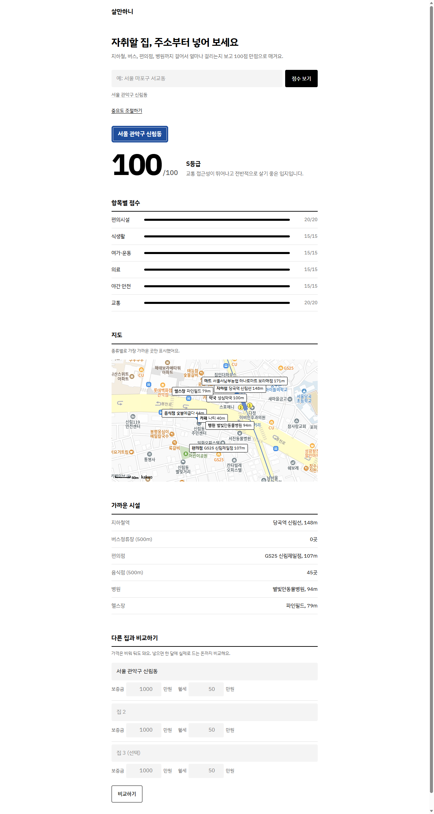

# 살만하니

자취할 집 주소를 넣으면 주변 생활 인프라(지하철·버스·편의점·병원 등)까지의 거리를 따져 **100점 만점 입지 점수**를 매겨 주는 웹앱입니다.



## 주요 기능

- **입지 점수와 등급**: 6개 항목 점수를 합산해 S~F 등급으로 표시
- **중요도 조절**: 슬라이더로 항목별 가중치를 바꿔 내 생활 패턴에 맞게 재계산
- **지도**: 카카오맵에 위치와 종류별 가장 가까운 시설 표시
- **가까운 시설 요약**: 지하철역, 버스정류장 수, 편의점, 음식점 수, 병원, 헬스장
- **집 비교**: 최대 3곳의 점수와 보증금·월세를 나란히 비교
- **AI 한줄평**: OpenAI 키가 있으면 GPT 코멘트, 없으면 규칙 기반 코멘트
- **최근 검색**: 브라우저(localStorage)에 저장
- **모바일 앱 화면**: 하단 탭(홈·비교·저장·MY)으로 화면 전환, 휴대폰 뒤로가기 지원
- **저장·체크리스트**: 로그인하면 분석 기록·즐겨찾기가 남고, 집마다 현장 체크리스트(10항목)와 메모
- **내 기본 중요도**: MY 탭에서 저장해 두면 로그인할 때마다 홈 점수에 적용

## 기술 스택

| 구분 | 사용 |
|------|------|
| 백엔드 | Python, Flask |
| 프론트엔드 | React + Vite, Emotion, GSAP, Chart.js, Pretendard |
| 외부 API | 카카오 로컬(주소→좌표, 장소 검색), 카카오맵 JS SDK, 공공데이터포털 TAGO 버스정류소, OpenAI |

## 점수 계산 방식

`scoring.py`에서 항목별로 0~1점을 낸 뒤 가중치를 곱해 합산합니다.

| 항목 | 기본 가중치 | 기준 |
|------|------|------|
| 교통 | 20 | 가장 가까운 지하철역 거리 + 버스정류장 수 |
| 편의시설 | 20 | 편의점·마트 |
| 식생활 | 15 | 음식점·카페 |
| 의료 | 15 | 병원·약국 |
| 여가·운동 | 15 | 헬스장 |
| 야간 안전 | 15 | 반경 300m CCTV 대수 40% + 가장 가까운 지구대·파출소 30% + 반경 500m 편의점 밀도 30% (CCTV 파일이 없으면 지구대·편의점 반반) |

등급: S(90+), A(80+), B(70+), C(60+), D(50+), F(50 미만)

## 실행 방법 (Docker)

Docker Desktop을 켜고, `.env`를 만든 뒤(`cp .env.example .env`) 프로젝트 폴더에서:

```bash
docker compose up -d --build   # http://localhost:5000
docker compose logs -f         # 로그 보기
docker compose down            # 끄기 (회원·기록 DB는 볼륨에 남음)
```

- 1단계에서 Node가 React 화면을 빌드하고, 2단계 Python 이미지가 그 결과를 Gunicorn(워커 2개)으로 서빙합니다.
- 회원 DB는 `salmanhani-data` 볼륨(`/app/data`)에 저장됩니다.
- `data/cctv.csv`는 이미지에 넣지 않고 읽기 전용으로 연결합니다. 파일이 없으면 야간 안전은 지구대·편의점만으로 계산합니다.
- 로컬에서 `python app.py`가 이미 5000번을 쓰고 있으면 `HOST_PORT=5050 docker compose up -d`로 다른 포트에 띄우세요.

## 실행 방법 (로컬 직접 실행)

```bash
pip install -r requirements.txt
cp .env.example .env   # 키 입력
cd frontend && npm install && npm run build && cd ..
python app.py          # http://localhost:5000
```

화면을 고치는 중에는 Flask를 켜 둔 채로 `cd frontend && npm run dev`를 실행하고 http://localhost:5173 에서 보면 저장할 때마다 바로 반영됩니다. (`/api` 요청은 Flask로 넘어갑니다.)

API 키가 없어도 실행됩니다. 카카오 키가 없으면 데모 데이터로, 공공데이터 키가 없으면 버스정류장만 데모 데이터로 동작합니다.

| 환경변수 | 용도 | 없으면 |
|------|------|------|
| `KAKAO_API_KEY` | 카카오 REST API (주소 변환·장소 검색) | 데모 모드 |
| `KAKAO_JS_KEY` | 카카오맵 표시 (실행 도메인 등록 필요) | 지도 미표시 |
| `DATA_GO_KR_API_KEY` | TAGO 버스정류소 조회 | 버스 데모 데이터 |
| `OPENAI_API_KEY` | AI 한줄평 | 규칙 기반 코멘트 |
| `SECRET_KEY` | 로그인 세션 서명 키 — **배포 시 반드시 설정** | 개발용 기본값 (공개돼 있어 배포엔 위험) |
| `DB_PATH` | 회원·기록 SQLite 파일 위치 | `salmanhi.db` (처음 실행 시 자동 생성) |
| `CCTV_CSV` | CCTV 데이터 파일 위치 | `data/cctv.csv` |

**CCTV 데이터:** 공공데이터포털에서 '전국CCTV표준데이터' → 파일데이터(CSV)를 받아 `data/cctv.csv`로 둡니다(약 80MB, git 제외). OpenAPI는 좌표·반경 검색이 안 돼서 파일을 서버 시작 때 메모리에 올려 씁니다. 지자체마다 등록 범위가 달라 지역 간 대수 차이가 큽니다.

**전월세 실거래:** `DATA_GO_KR_API_KEY`를 그대로 쓰지만, data.go.kr에서 국토교통부 아파트·오피스텔·연립다세대·단독/다가구 전월세 실거래가 서비스(요청주소에 `Rent`가 들어간 것, `Trade`는 매매)를 각각 활용신청해야 합니다. 신청 전에는 결과 화면에서 해당 섹션만 숨겨집니다. 단독/다가구는 지번을 가려서 공개하므로 건물 단위가 아니라 '이 동네 원룸(40㎡ 이하) 월세 시세'로 보여줍니다.

## 파일 구조

```
app.py          Flask 라우트 (분석·비교, 회원, 기록·즐겨찾기)
db.py           회원·분석 기록 저장 (SQLite)
test_auth.py    회원·기록 API 점검: python test_auth.py → ok
kakao.py        카카오 주소 변환·카테고리별 장소 검색
bus.py          TAGO 버스정류장 조회, 거리 계산
cctv.py         CCTV CSV 로드·반경 내 대수: python cctv.py → ok
rent.py         국토부 전월세 실거래 조회·요약: python rent.py → ok
scoring.py      항목별 점수·가중치·등급 계산
frontend/
  src/App.jsx               검색 상태·API 호출, 하단 탭·화면 전환(#home, #my/account 같은 주소)
  src/components/           SearchSection, Results, CategoryChart, KakaoMap, Compare,
                            Saved(기록·체크리스트), Account(MY 탭)
  src/styles.jsx            색 토큰·공용 Emotion 컴포넌트
  src/lib.js                상수·최근 검색·가격 계산
```
